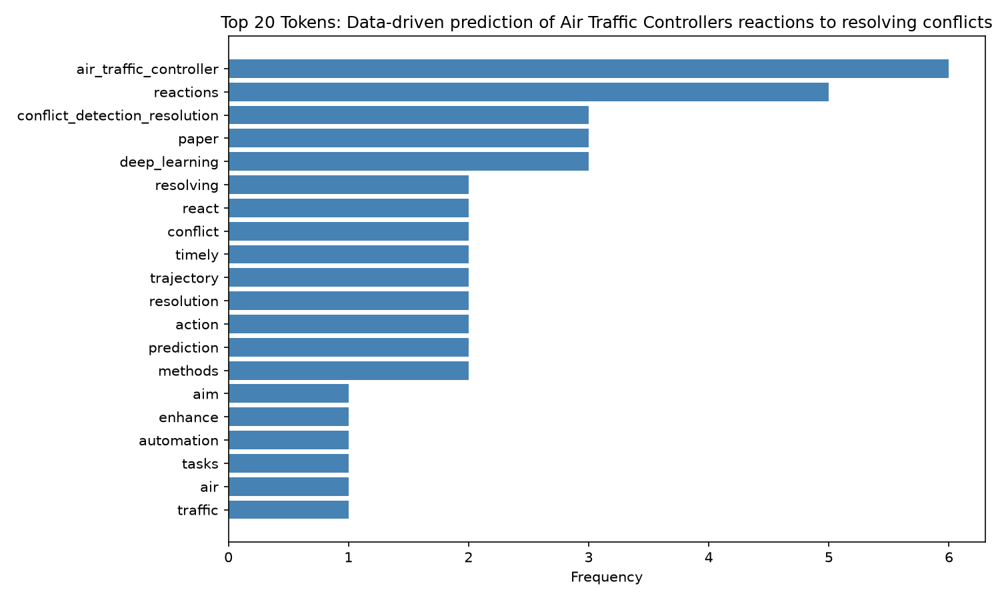

# nlp-06-nlp-pipeline-custom

[](https://github.com/KHenn22/nlp-06-nlp-pipeline-custom/actions/workflows/ci-python-zensical.yml)
[](https://khenn22.github.io/nlp-06-nlp-pipeline-custom/)
[](https://docs.astral.sh/uv/)

**Author:** Kevin Hennelly

**Date:** November 2026

**Course:** Web Mining and Applied NLP, Project 06

## Project Overview

This project examines how standardizing abbreviations changes the vocabulary
measurements of an air traffic control research abstract. It adapts Denise Case's
Extract, Validate, Transform, Analyze, Load (EVTAL) pipeline to the same ATC paper
used in my Module 05 project.

The custom pipeline processes the abstract twice: once with the existing cleaning
steps and once with three additional rules that combine full terms and their
abbreviations into shared labels. It compares token frequencies, total and unique
token counts, type-token ratio, and average token length. Separate CSVs and charts
are saved for each version, along with a combined comparison CSV.

The [full project report](https://khenn22.github.io/nlp-06-nlp-pipeline-custom/)
explains the data, methods, findings, limitations, and next steps.

## Data and Approach

The source is the HTML abstract page for
[Data-driven prediction of Air Traffic Controllers reactions to resolving conflicts](https://arxiv.org/abs/2205.09539)
by Alevizos Bastas and George A. Vouros. The analysis uses the abstract and
bibliographic metadata, rather than the full paper or operational ATC records.

Requests retrieves the page, BeautifulSoup extracts and validates its structure,
spaCy cleans and tokenizes the abstract, Pandas organizes the measurements, and
Matplotlib and WordCloud create the visualizations. Python regular expressions
apply the custom standardization rules before tokenization.

| Full term and abbreviation | Shared label |
| --- | --- |
| Air Traffic Controller(s); ATCO(s) | `air_traffic_controller` |
| Deep learning; DL | `deep_learning` |
| Conflict detection and resolution; CD&R | `conflict_detection_resolution` |

Both versions lowercase the text and remove spaCy stopwords, punctuation tokens,
and whitespace tokens. Neither version applies stemming or lemmatization.
Only the standardization setting changes between the two versions.

## Results

| Measurement | Baseline | Standardized |
| --- | ---: | ---: |
| Cleaned token count | 88 | 83 |
| Unique token count | 62 | 59 |
| Type-token ratio | 0.7045 | 0.7108 |
| Average token length, characters | 6.8182 | 9.2289 |

### Standardized Token Frequencies



Standardization grouped the full and abbreviated forms of selected concepts.
Token count and unique token count decreased, while type-token ratio increased
slightly. Average token length increased because several words or a short acronym
were replaced with one longer label; underscores also count as characters.
These changes demonstrate the effect of preprocessing on text statistics.
They do not establish improved predictive accuracy or greater writing complexity.

## Project Commands

Install Git, VS Code, and uv using the
[Professional Python Workflow Guide](https://denisecase.github.io/pro-analytics-02/).
Run the commands below in PowerShell. After cloning, run all remaining commands
from the repository root, where `pyproject.toml` is located.

### Get the Project

```powershell
git clone https://github.com/KHenn22/nlp-06-nlp-pipeline-custom.git
cd nlp-06-nlp-pipeline-custom
```

### Set Up the Environment

The project uses Python 3.14. The spaCy `en_core_web_sm` model and the development
and documentation dependencies are declared in `pyproject.toml`.

```powershell
uv python install
uv sync --frozen
```

For the instructor's environment maintenance workflow:

```powershell
uvx pup-clean --delete
uv self update
uv python pin 3.14
uv python install
uv lock --upgrade
uv sync
uv audit
```

### Set Up and Run Git Hooks

```powershell
uvx prek install --force
uvx prek update --freeze --cooldown-days 7
git add -A
uvx prek run --all-files
```

If a hook modifies files, stage the changes and run the hooks again:

```powershell
git add -A
uvx prek run --all-files
```

### Run the Custom ATC Comparison

```powershell
uv run python -m nlp.pipeline_web_html_d3_hennelly
```

Successful execution ends with `Pipeline executed successfully!`.
Inspect the combined CSV in PowerShell:

```powershell
Import-Csv .\data\processed\d3_hennelly_processed.csv |
    Format-Table preprocessing, token_count, unique_token_count, type_token_ratio, average_token_length -AutoSize
```

The combined file should contain two rows: `baseline` and `standardized`.

### Run the Original Example or D2 Experiment

```powershell
uv run python -m nlp.pipeline_web_html
uv run python -m nlp.pipeline_web_html_d2_hennelly
```

### Run Common Chores and Preview the Documentation

```powershell
uv run ruff check . --fix
uv run ruff format .
uv run ty check
uv run python -m pytest
uv run python -m zensical build
```

To preview the website locally:

```powershell
uv run python -m zensical serve --open
```

Press `Ctrl+C` to stop the preview. In VS Code, use `Ctrl+Shift+V` to preview
`README.md` or `docs/index.md`.

### Save Changes to GitHub

```powershell
git add -A
git commit -m "Finalize ATC analysis documentation and results"
git push -u origin main
```

Check the [Actions tab](https://github.com/KHenn22/nlp-06-nlp-pipeline-custom/actions)
after pushing. CI checks the repository, and the documentation workflow publishes
the website to GitHub Pages.

## Custom Output Files

| Path | Contents |
| --- | --- |
| `data/raw/d3_hennelly_raw.html` | Retrieved HTML source |
| `data/processed/d3_hennelly_baseline.csv` | One baseline result row |
| `data/processed/d3_hennelly_standardized.csv` | One standardized result row |
| `data/processed/d3_hennelly_processed.csv` | Both result rows for comparison |
| `data/processed/d3_hennelly_baseline/` | Baseline frequency chart and word cloud |
| `data/processed/d3_hennelly_standardized/` | Standardized frequency chart and word cloud |
| `docs/images/d3_*.png` | Copies of custom visuals used in the published report |

When rerunning the analysis changes the charts, refresh the documentation copies:

```powershell
Copy-Item .\data\processed\d3_hennelly_baseline\d3_hennelly_top_tokens.png .\docs\images\d3_baseline_top_tokens.png
Copy-Item .\data\processed\d3_hennelly_baseline\d3_hennelly_wordcloud.png .\docs\images\d3_baseline_wordcloud.png
Copy-Item .\data\processed\d3_hennelly_standardized\d3_hennelly_top_tokens.png .\docs\images\d3_standardized_top_tokens.png
Copy-Item .\data\processed\d3_hennelly_standardized\d3_hennelly_wordcloud.png .\docs\images\d3_standardized_wordcloud.png
```

## D2: Average Token Length Experiment

**Modification:** I added `average_token_length` to the Transform stage and
saved it in a separate [D2 CSV](data/processed/d2_hennelly_processed.csv).

**Reason and prediction:** This feature provides another description of the
abstract's vocabulary and can be reused for the ATC paper. Before running it,
I predicted a relatively high average because the example abstract contains
technical terms. I expected the existing counts and frequencies to stay unchanged.

**Observed result:** The D2 example produced an average token length of
7.9769 characters, with 130 cleaned tokens, 118 unique tokens, and a type-token
ratio of 0.9077. The added calculation left the existing measurements unchanged.

**What I learned:** A feature can be calculated from existing cleaned tokens
without changing the underlying text. Its interpretation depends on how tokens
are represented, as the D3 comparison demonstrates.

[D2 Transform code](src/nlp/stage03_transform_d2_hennelly.py)

## Project Files

- [D3 pipeline](src/nlp/pipeline_web_html_d3_hennelly.py): runs both versions and combines their results.
- [D3 configuration](src/nlp/config_d3_hennelly.py): source URL and output paths.
- [D3 Transform stage](src/nlp/stage03_transform_d3_hennelly.py): cleaning, standardization, and metrics.
- [D3 Analyze stage](src/nlp/stage04_analyze_d3_hennelly.py): top-token charts and word clouds.
- [Project report](docs/index.md): observations, interpretation, limitations, and next steps.

## Links

- [Hosted project documentation](https://khenn22.github.io/nlp-06-nlp-pipeline-custom/)
- [Original example adapted: Denise Case's NLP pipeline](https://github.com/denisecase/nlp-06-nlp-pipeline)
- [ATC data source](https://arxiv.org/abs/2205.09539)
- [D2 example data source](https://arxiv.org/abs/2602.20021)
- [Combined comparison CSV](data/processed/d3_hennelly_processed.csv)
- [Commit history](https://github.com/KHenn22/nlp-06-nlp-pipeline-custom/commits/main/)
- [GitHub Actions](https://github.com/KHenn22/nlp-06-nlp-pipeline-custom/actions)
- [Professional Python Workflow Guide](https://denisecase.github.io/pro-analytics-02/)
- [Citation](CITATION.cff)
- [License](LICENSE)
